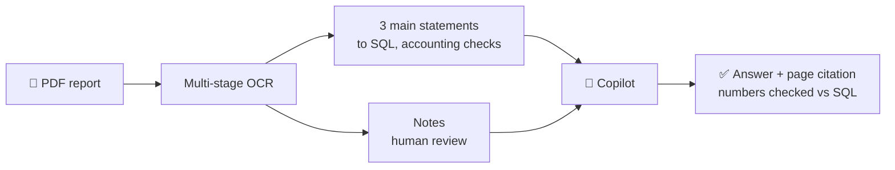

 

---

## ⚡ Quick look

| 📄 OCR | 🤖 Copilot | 🔭 Monitoring | 🔬 Research |
|:---:|:---:|:---:|:---:|
| **~50 pages** in under **5 min** zero cost | **95%** SQL accuracy **90%** citation precision **96%** faithfulness | **5** data-quality failures + freshness breach auto-resolved | **1st author** **ICCVR 2026** FAISS benchmark |

Copilot numbers come from a 50-question benchmark I built myself over one 54-page audited report, so read them as a development check.

---

## 👨‍💻 About me

- 🎓 Studying **Management Information Systems** at UEL, VNU-HCM (expected May 2027, GPA 8.13/10)
- 🧪 **BAAI Lab:** built the web platform for predicting Metal-Organic Framework properties and integrated the lab's models (I did not train the models)
- 🏫 **ITAC (UEL):** studying the core of the deployed admissions chatbot and onboarding other team members; designated main developer of the core RAG for the department chatbots (Academic Affairs, Quality Assurance, Administration, HR) once that phase begins
- 📚 I like reading scientific research, economics, politics and culture
- 🤝 Open to internships and research collaborations in AI Engineering, Data Engineering and Applied ML

---

## 🛠️ Toolbox

**Languages** 

**LLM apps · Document AI · Search** 

**Data engineering · Backend · Ops** 

---

## 🚀 Featured projects

| Project | What it does | Highlight |
|---|---|---|
| 📄 **OpenBCTC** | Multi-stage OCR for Vietnamese financial statements. Main statements go to SQL and are validated by accounting rules; notes are reviewed in a browser interface and exported to Markdown. | ~50 pages in under 5 min, zero cost |
| 🤖 **OpenBCTC Copilot** | LangGraph chatbot on top of OpenBCTC data: SQL engine for figures, hybrid retrieval for notes, fact-check step, page-level citations with a highlighted PDF viewer. | 95% SQL accuracy, 96% faithfulness |
| 🔭 **NorthStream** *(team of 3, my part: monitoring and alerting)* | Prometheus and Grafana dashboards, alerts for lag, stalled jobs, freshness and data quality, delivered to PagerDuty with auto-resolve. | Tested with simulated failures end to end |
| 🚢 **Zero-stop e-Border** | Customs platform with an HS-code assistant, document verification and a risk dashboard. | 🥈 2nd Prize (team leader), AI in Business S3 |
| 🍅 **TomatoAI** | v1 greenhouse assistant prototype: sensor alerts, leaf disease diagnosis, ripeness grading, voice consultation over Telegram. Coursework, team lead. | n8n, Telegram, computer vision |

---

## 📝 Research

> **When Does Approximate Search Preserve Composed Image Retrieval Quality? A Scale-Aware FAISS Benchmark**
> 🥇 First author · Accepted at **ICCVR 2026** (Paper ID: V377)

- Reproduced three zero-shot CIR models (CLIP4Cir, SEARLE, Pic2Word) under one evaluation harness and fixed two reproducibility bugs that would have invalidated the measurements.
- Benchmarked FAISS **HNSWFlat**, **IVFFlat** and **IVFPQ** on FashionIQ, CIRR and CIRCO, sweeping parameters to find the sweet spot between quality and query cost.
- 📉 Large speedups on the 123K-image CIRCO gallery, but only **1 to 5x** on 2 to 6K-image galleries.
- ⚖️ HNSWFlat is usually, but not always, faster than IVFFlat at matched retention, so the best index is **model-dependent**.
- 🚫 No tested IVFPQ configuration reached **95%** retention.

---

## 📊 GitHub stats

---

*Let's connect and build something good together.*

